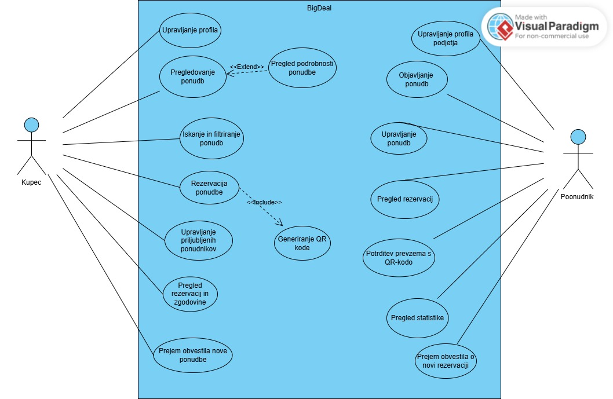

# BigDeal

## 1. Opis projekta

**BigDeal** je mobilna aplikacija za odkrivanje ugodnih lokalnih ponudb, ki povezuje kupce z različnimi ponudniki fizičnih izdelkov, kot so pekarne, kavarne, restavracije ter trgovine z živili, oblačili, elektroniko, kozmetiko in drugimi izdelki.

Aplikacija omogoča, da uporabniki na enem mestu pregledujejo aktualne popuste in posebne ponudbe lokalnih podjetij. Ponudniki lahko z objavljanjem ugodnosti povečajo svojo prepoznavnost, privabijo nove kupce ter zmanjšajo količino neprodanih izdelkov.

## 2. Problem in vizija

Informacije o lokalnih popustih so pogosto razpršene med spletnimi stranmi, družbenimi omrežji in posameznimi trgovinami. Kupci zato težko najdejo in primerjajo ugodne ponudbe v svoji bližini.

**Vizija BigDeal** je ustvariti enotno platformo, ki kupcem olajša odkrivanje lokalnih ugodnosti, ponudnikom pa omogoča učinkovito predstavitev akcij in prodajo izdelkov po znižanih cenah.

Projekt zasleduje tri glavne cilje:

- **Prihranek kupcev:** enostavno odkrivanje ugodnih izdelkov in aktualnih popustov.
- **Podpora lokalnim ponudnikom:** večja prepoznavnost, doseganje novih strank in izboljšanje prodaje.
- **Zmanjševanje neprodanih izdelkov:** možnost ponudbe preostalih izdelkov po znižanih cenah.

## 3. Vrste ponudb

BigDeal podpira dve vrsti ponudb.

### 3.1 Promocijske ponudbe

Promocijske ponudbe predstavljajo aktualne akcije, sezonske popuste in druge ugodnosti lokalnih podjetij.

Kupec lahko pregleda pogoje ponudbe, vendar izdelka ne rezervira prek aplikacije. Nakup opravi neposredno pri ponudniku.

**Primer:** Trgovina z oblačili objavi 30 % popusta na izbrane jesenske jakne.

### 3.2 Rezervacijske ponudbe

Rezervacijske ponudbe omogočajo rezervacijo omejene količine izdelkov po znižani ceni.

Kupec izbere izdelek, količino in termin prevzema. Po uspešni rezervaciji prejme QR-kodo, ki jo ponudnik ob prevzemu skenira in potrdi izročitev izdelkov.

**Primer:** Pekarna ponudi paket peciva, znižan z 8 € na 4 €, z možnostjo rezervacije in osebnega prevzema.

Posamezen ponudnik lahko objavlja promocijske ponudbe, rezervacijske ponudbe ali obe vrsti.

## 4. Uporabniki aplikacije

Aplikacija vključuje dve glavni uporabniški vlogi:

- **Kupec:** pregleduje ponudbe, išče in filtrira ugodnosti, rezervira izdelke ter spremlja svoje rezervacije.
- **Ponudnik:** upravlja profil podjetja, objavlja ponudbe, spremlja rezervacije in potrjuje prevzeme.

Isti registrirani uporabnik lahko nastopa kot kupec in kot ponudnik, če ima ustvarjen profil podjetja.

## 5. Glavne funkcionalnosti

### 5.1 Funkcionalnosti za kupce

- Registracija, prijava in upravljanje uporabniškega profila.
- Pregled aktualnih promocijskih in rezervacijskih ponudb.
- Iskanje in filtriranje po lokaciji, kategoriji, vrsti ponudbe, ceni in popustu.
- Pregled ponudnikov in ponudb na zemljevidu.
- Pregled podrobnosti posamezne ponudbe.
- Rezervacija izdelkov z izbiro količine in termina prevzema.
- Pridobitev QR-kode za prevzem rezerviranih izdelkov.
- Shranjevanje priljubljenih ponudnikov.
- Prejemanje obvestil o ponudbah in rezervacijah.
- Pregled rezervacij, zgodovine in ocenjenih prihrankov.

### 5.2 Funkcionalnosti za ponudnike

- Registracija in upravljanje profila podjetja.
- Objavljanje promocijskih in rezervacijskih ponudb.
- Urejanje, posodabljanje in odstranjevanje ponudb.
- Pregled prejetih rezervacij in njihovih statusov.
- Skeniranje QR-kod in potrjevanje prevzemov.
- Pregled osnovne statistike ponudb in rezervacij.
- Prejemanje obvestil o novih rezervacijah.

## 6. Meje projekta

Začetna različica BigDeal je namenjena lokalnim ponudbam **fizičnih izdelkov**.

V začetni različici niso predvideni:

- Spletno plačevanje – kupec plača neposredno pri ponudniku.
- Dostava izdelkov – prevzem poteka osebno.
- Rezervacije storitev – aplikacija je osredotočena na fizične izdelke.

## 7. Diagram primerov uporabe

Spodnji diagram prikazuje glavne funkcionalnosti sistema BigDeal in interakcije med obema akterjema, kupcem in ponudnikom.

Podrobnejši poteki izbranih funkcionalnosti, vključno s predpogoji, vhodi, alternativnimi poteki in rezultati, so opisani v dokumentu:

**[Ključni uporabniški scenariji](02-uporabniski-scenariji.md)**

## 8. Povezana dokumentacija

- [Ključni uporabniški scenariji](02-uporabniski-scenariji.md)
- [Arhitektura sistema](03-arhitektura.md)
- [Podatkovni model](04-podatkovni-model.md)
- [Pravila razvoja](05-pravila-razvoja.md)
