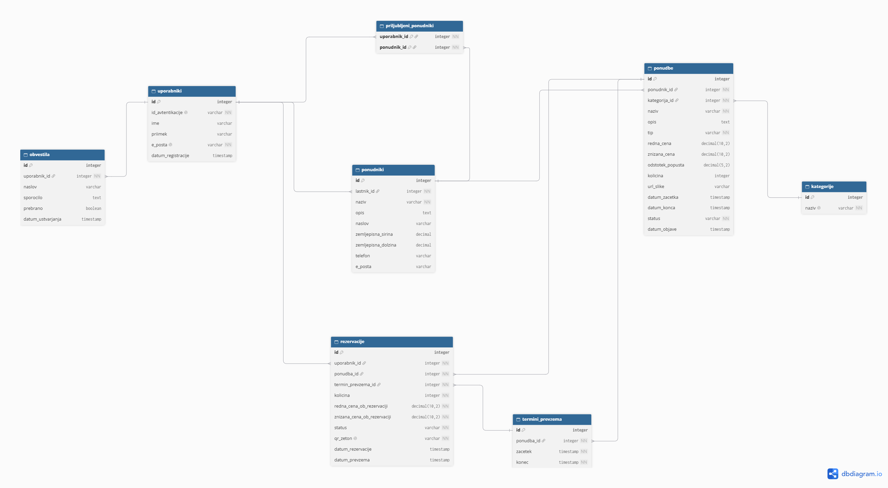

# BigDeal – Arhitektura sistema

## 1. Pregled arhitekture

BigDeal temelji na arhitekturi odjemalec–strežnik, ki ločuje mobilno aplikacijo, zaledni sistem in podatkovno bazo.

Mobilna aplikacija omogoča uporabniško interakcijo, prikaz ponudb, ustvarjanje rezervacij in upravljanje ponudnikovih funkcionalnosti. Zaledni sistem bo skrbel za poslovno logiko, preverjanje podatkov, avtorizacijo in komunikacijo s podatkovno bazo.

Arhitektura je zasnovana modularno, tako da omogoča neodvisen razvoj posameznih funkcionalnosti in postopno nadgrajevanje sistema.

## 2. Arhitekturni diagram



Diagram prikazuje povezave med naslednjimi komponentami:

- **Mobilna aplikacija:** React Native, Expo in TypeScript.
- **Zaledni sistem:** Spring Boot REST API v programskem jeziku Java.
- **Podatkovna baza:** PostgreSQL.
- **Avtentikacija:** Spring Security in JWT.
- **Zemljevidi in lokacija:** React Native Maps in Expo Location.
- **QR-kode:** generiranje QR-kod in skeniranje z Expo Camera.
- **Fotografije:** Azure Blob Storage.
- **Obvestila:** Expo Notifications.

Mobilna aplikacija bo z zalednim sistemom komunicirala prek protokola HTTPS in REST API-ja. Dostop do podatkovne baze bo potekal izključno prek zalednega sistema.

## 3. Tehnološki sklad

### 3.1 Mobilna aplikacija

Mobilna aplikacija uporablja naslednje tehnologije:

- **React Native:** razvoj mobilnega uporabniškega vmesnika.
- **Expo:** razvojno okolje in dostop do funkcionalnosti naprav.
- **TypeScript:** tipizacija podatkov in programske logike.
- **Expo Router:** navigacija med zasloni.
- **React Native Maps in Expo Location:** prikaz lokacij ponudnikov in geolokacijske funkcionalnosti.
- **Expo Camera:** skeniranje QR-kod.
- **react-native-qrcode-svg:** generiranje QR-kod rezervacij.

Mobilna aplikacija se razvija v mapi `mobile/`.

### 3.2 Zaledni sistem

Predviden zaledni sistem uporablja:

- **Java 21:** programski jezik.
- **Spring Boot:** razvoj zalednega sistema.
- **Spring Web:** implementacija REST API-ja.
- **Spring Data JPA / Hibernate:** dostop do podatkovne baze.
- **Spring Security in JWT:** avtentikacija in avtorizacija uporabnikov.

Zaledni sistem bo odgovoren za preverjanje poslovnih pravil, ustvarjanje rezervacij, upravljanje zaloge ter varno potrjevanje prevzemov.

Koda zalednega sistema bo shranjena v mapi `backend/`.

### 3.3 Podatkovna baza

Za trajno shranjevanje podatkov je predvidena relacijska podatkovna baza **PostgreSQL**.

Podatkovni model vključuje uporabnike, ponudnike, kategorije, ponudbe, termine prevzema, rezervacije, priljubljene ponudnike in obvestila.

Podrobnosti so opisane v dokumentu [Podatkovni model](04-podatkovni-model.md).

### 3.4 Zunanje storitve

Za dodatne funkcionalnosti so predvidene:

- **Azure Blob Storage:** shranjevanje fotografij ponudb.
- **Expo Notifications in Expo Push Service:** pošiljanje potisnih obvestil.
- **Zemljevidi in lokacijske storitve:** prikaz ponudnikov na zemljevidu in iskanje glede na lokacijo uporabnika.

Konfiguracija zunanjih storitev bo določena ob njihovi implementaciji.

## 4. Organizacija mobilne aplikacije

Mobilna aplikacija je organizirana po funkcionalnostih (*feature-based architecture*).

Glavne mape:

```text
mobile/
├── assets/
│   └── images/
├── src/
│   ├── app/
│   ├── features/
│   │   ├── auth/
│   │   ├── favorites/
│   │   ├── offers/
│   │   ├── provider/
│   │   └── reservations/
│   ├── shared/
│   ├── models/
│   ├── data/
│   │   ├── mock/
│   │   ├── repositories/
│   │   └── mockStore.ts
│   └── theme/
├── package.json
└── tsconfig.json
```

### 4.1 Navigacija – `src/app/`

Mapa `app/` vsebuje navigacijske datoteke Expo Routerja.

Navigacijske datoteke so namenjene povezovanju poti s pripadajočimi zasloni. Poslovna logika in kompleksnejši uporabniški vmesniki se ne implementirajo neposredno v navigacijskih datotekah.

### 4.2 Funkcionalnosti – `src/features/`

Vsaka večja funkcionalnost ima svojo mapo:

- `auth/` – prijava, registracija in uporabniški profil.
- `offers/` – pregled, iskanje, filtriranje in podrobnosti ponudb.
- `reservations/` – ustvarjanje rezervacij, QR-kode in zgodovina.
- `provider/` – ponudnikov začetni zaslon, upravljanje podjetja in ponudb.
- `favorites/` – priljubljeni ponudniki.

Posamezni zasloni bodo organizirani v ločenih mapah znotraj pripadajoče funkcionalnosti.

Primer organizacije:

```text
features/
└── offers/
    ├── screens/
    │   ├── OfferList/
    │   │   ├── OfferListScreen.tsx
    │   │   └── OfferFilters.tsx
    │   └── OfferDetails/
    │       └── OfferDetailsScreen.tsx
    └── components/
        └── OfferCard.tsx
```

Komponente, ki jih uporablja več zaslonov iste funkcionalnosti, se hranijo v mapi `components/` te funkcionalnosti.

### 4.3 Skupne komponente – `src/shared/`

Mapa `shared/` vsebuje ponovno uporabne komponente in funkcije, ki niso vezane na posamezno funkcionalnost.

Primeri so gumbi, vnosna polja, indikatorji nalaganja in skupni React hooki.

### 4.4 Podatkovni modeli – `src/models/`

Mapa `models/` vsebuje TypeScript podatkovne modele, ki opredeljujejo strukturo podatkov v aplikaciji.

Trenutno vključuje modele:

- `User`
- `Business`
- `Category`
- `Offer`
- `PickupSlot`
- `Reservation`

Modeli so skupni vsem funkcionalnostim.

### 4.5 Podatkovna plast – `src/data/`

Podatkovna plast ločuje uporabniški vmesnik od načina pridobivanja in shranjevanja podatkov.

Sestavljajo jo:

- `mock/` – začetni demonstracijski podatki v formatu JSON.
- `mockStore.ts` – centralna začasna shramba podatkov.
- `repositories/` – metode za dostop do podatkov in izvajanje operacij nad njimi.

Trenutno so implementirani:

- `offerRepository.ts`
- `businessRepository.ts`
- `reservationRepository.ts`

Zasloni pridobivajo in spreminjajo podatke prek repozitorijev, ne neposredno prek JSON datotek.

### 4.6 Oblikovanje – `src/theme/`

Mapa `theme/` je namenjena skupnim nastavitvam videza aplikacije:

- Barvam.
- Tipografiji.
- Razmikom.
- Zaobljenosti elementov.

S tem zagotavljamo enoten videz različnih zaslonov.


## 5. Glavni poslovni procesi

### 5.1 Pregledovanje ponudb

1. Kupec odpre seznam ponudb.
2. Aplikacija pridobi ponudbe prek podatkovne plasti.
3. Kupec uporabi iskalnik ali filtre.
4. Sistem prikaže ustrezne ponudbe.
5. Kupec lahko odpre podrobnosti izbrane ponudbe.

### 5.2 Rezervacija izdelka

1. Kupec izbere rezervacijsko ponudbo.
2. Določi količino in termin prevzema.
3. Sistem preveri veljavnost ponudbe, termin in zalogo.
4. Ob uspešni rezervaciji sistem ustvari zapis rezervacije in zmanjša razpoložljivo količino.
5. Kupec prejme QR-kodo za prevzem.

V končni implementaciji bo preverjanje in spreminjanje zaloge potekalo transakcijsko na zalednem sistemu.

### 5.3 Potrditev prevzema

1. Kupec ponudniku pokaže QR-kodo.
2. Ponudnik QR-kodo skenira s kamero naprave.
3. Sistem preveri rezervacijo in njeno pripadnost ponudniku.
4. Ponudnik po izročitvi izdelka potrdi prevzem.
5. Sistem posodobi status rezervacije.

Plačilo se izvede neposredno pri ponudniku in ni del aplikacije.


## 6. Povezana dokumentacija

- [Opis projekta](01-opis-projekta.md)
- [Ključni uporabniški scenariji](02-uporabniski-scenariji.md)
- [Podatkovni model](04-podatkovni-model.md)
- [Pravila razvoja](05-pravila-razvoja.md)