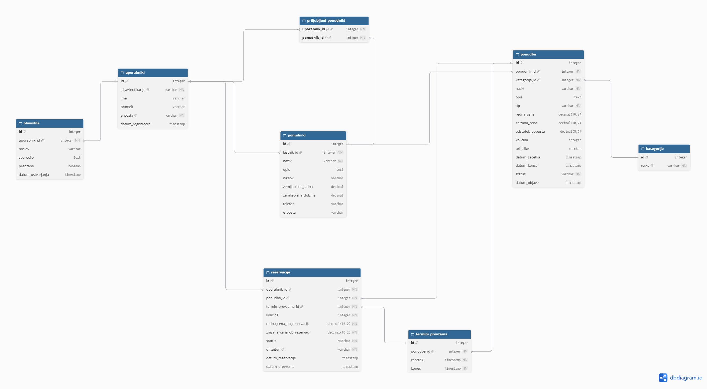

# BigDeal – Podatkovni model

## 1. Pregled podatkovnega modela

Podatkovni model BigDeal temelji na relacijski podatkovni bazi **PostgreSQL** in je zasnovan za upravljanje uporabnikov, lokalnih ponudnikov, ponudb in rezervacij izdelkov.

Model omogoča objavljanje dveh vrst ponudb: promocijskih in rezervacijskih. Pri rezervacijskih ponudbah dodatno podpira določanje količine, izbiro termina prevzema in potrditev prevzema s QR-kodo.

## 2. ER-diagram

Diagram prikazuje osem glavnih entitet in njihove medsebojne povezave.

## 3. Entitete

### 3.1 Uporabniki (`uporabniki`)

Entiteta hrani osnovne podatke o registriranih uporabnikih aplikacije.

**Glavni atributi:**
- `id` – enolični identifikator uporabnika.
- `id_avtentikacije` – identifikator uporabnika v sistemu za avtentikacijo.
- `ime`, `priimek` – osebni podatki.
- `e_posta` – elektronski naslov.
- `datum_registracije` – datum ustvarjanja računa.

Uporabnik lahko nastopa kot kupec in kot lastnik enega ali več podjetij. Zato podatkovni model ne zahteva ločenih uporabniških računov za kupce in ponudnike.

### 3.2 Ponudniki (`ponudniki`)

Entiteta predstavlja podjetja, ki v aplikaciji objavljajo svoje ponudbe.

**Glavni atributi:**
- `id` – identifikator podjetja.
- `lastnik_id` – povezava z lastnikom podjetja.
- `naziv`, `opis` – osnovne informacije o podjetju.
- `naslov` – fizična lokacija podjetja.
- `zemljepisna_sirina`, `zemljepisna_dolzina` – geografski koordinati.
- `telefon`, `e_posta` – kontaktni podatki.

Posamezno podjetje lahko objavi več ponudb. Geografski koordinati omogočata prikaz podjetja na zemljevidu in iskanje ponudb glede na lokacijo.

### 3.3 Kategorije (`kategorije`)

Entiteta določa kategorije izdelkov oziroma ponudb.

**Atributa:**
- `id` – identifikator kategorije.
- `naziv` – ime kategorije.

Primeri kategorij so Hrana in pijača, Moda in obutev, Elektronika ter Kozmetika in nega.

Kategorije omogočajo preglednejše razvrščanje, iskanje in filtriranje ponudb.

### 3.4 Ponudbe (`ponudbe`)

Entiteta predstavlja izdelke ali promocijske akcije, ki jih objavljajo ponudniki.

**Glavni atributi:**
- `id` – identifikator ponudbe.
- `ponudnik_id` – povezava s podjetjem.
- `kategorija_id` – povezava s kategorijo.
- `naziv`, `opis` – informacije o ponudbi.
- `tip` – vrsta ponudbe.
- `redna_cena`, `znizana_cena` – podatki o ceni.
- `odstotek_popusta` – višina popusta.
- `kolicina` – razpoložljiva količina izdelkov.
- `url_slike` – povezava do fotografije.
- `datum_zacetka`, `datum_konca` – obdobje veljavnosti.
- `status` – stanje ponudbe.
- `datum_objave` – datum objave.

**Vrsti ponudb:**

- **Promocijska ponudba (`PROMOTION`):** predstavlja popust ali akcijo brez možnosti rezervacije. Pri akcijah za več izdelkov so lahko podatki o konkretnih cenah in količini prazni.
- **Rezervacijska ponudba (`RESERVABLE`):** omogoča rezervacijo določene količine izdelkov po znižani ceni in zahteva razpoložljive termine prevzema.

Podatkovni model tako podpira obe vrsti ponudb brez podvajanja entitet.

### 3.5 Termini prevzema (`termini_prevzema`)

Entiteta določa časovne intervale, v katerih lahko kupec prevzame rezervirane izdelke.

**Atributi:**
- `id` – identifikator termina.
- `ponudba_id` – povezava s ponudbo.
- `zacetek` – začetek časovnega intervala.
- `konec` – konec časovnega intervala.

Ena rezervacijska ponudba ima lahko več terminov prevzema. Kupec ob rezervaciji izbere enega izmed razpoložljivih terminov.

Promocijske ponudbe ne potrebujejo terminov prevzema.

### 3.6 Rezervacije (`rezervacije`)

Entiteta hrani podatke o rezervacijah izdelkov.

**Glavni atributi:**
- `id` – identifikator rezervacije.
- `uporabnik_id` – uporabnik, ki je ustvaril rezervacijo.
- `ponudba_id` – rezervirana ponudba.
- `termin_prevzema_id` – izbrani termin prevzema.
- `kolicina` – rezervirana količina.
- `redna_cena_ob_rezervaciji` – redna cena enega izdelka ob rezervaciji.
- `znizana_cena_ob_rezervaciji` – znižana cena enega izdelka ob rezervaciji.
- `status` – stanje rezervacije.
- `qr_zeton` – enolični žeton za identifikacijo rezervacije.
- `datum_rezervacije` – datum ustvarjanja rezervacije.
- `datum_prevzema` – datum potrjenega prevzema.

Shranjevanje cen ob rezervaciji zagotavlja, da poznejše spremembe ponudbe ne vplivajo na že ustvarjene rezervacije.

**Statusi rezervacij:**
- `CONFIRMED` – potrjena rezervacija.
- `COMPLETED` – uspešno prevzeti izdelki.
- `CANCELLED` – preklicana rezervacija.
- `EXPIRED` – potekla rezervacija.

QR-žeton omogoča preverjanje rezervacije ob osebnem prevzemu. Njegovo veljavnost in pripadnost ponudniku mora preverjati zaledni sistem.

### 3.7 Priljubljeni ponudniki (`priljubljeni_ponudniki`)

Entiteta povezuje uporabnike s podjetji, ki so jih označili kot priljubljene.

**Atributa:**
- `uporabnik_id` – identifikator uporabnika.
- `ponudnik_id` – identifikator priljubljenega podjetja.

Gre za povezovalno entiteto med uporabniki in ponudniki.

Kombinacija obeh identifikatorjev predstavlja sestavljeni primarni ključ, ki preprečuje podvojene vnose istega priljubljenega podjetja pri istem uporabniku.

### 3.8 Obvestila (`obvestila`)

Entiteta predstavlja obvestila, namenjena uporabnikom aplikacije.

**Glavni atributi:**
- `id` – identifikator obvestila.
- `uporabnik_id` – prejemnik obvestila.
- `naslov` – naslov obvestila.
- `sporocilo` – vsebina.
- `prebrano` – oznaka, ali je uporabnik obvestilo že prebral.
- `datum_ustvarjanja` – datum nastanka obvestila.

Obvestila se lahko uporabljajo za informiranje o novih ponudbah, rezervacijah in terminih prevzema.

## 4. Povezave med entitetami

Podatkovni model vsebuje naslednje povezave:

- **Uporabnik → Ponudniki (1:N):** uporabnik je lahko lastnik več podjetij.
- **Ponudnik → Ponudbe (1:N):** podjetje lahko objavi več ponudb.
- **Kategorija → Ponudbe (1:N):** kategoriji lahko pripada več ponudb.
- **Ponudba → Termini prevzema (1:N):** rezervacijska ponudba lahko omogoča več terminov.
- **Uporabnik → Rezervacije (1:N):** uporabnik lahko ustvari več rezervacij.
- **Ponudba → Rezervacije (1:N):** posamezna ponudba ima lahko več rezervacij.
- **Termin prevzema → Rezervacije (1:N):** isti termin lahko izbere več kupcev.
- **Uporabnik ↔ Ponudnik (N:M):** povezava priljubljenih ponudnikov.
- **Uporabnik → Obvestila (1:N):** uporabnik lahko prejme več obvestil.

Tu oznaka 1:N pomeni povezavo *eden proti mnogo*, N:M pa *mnogo proti mnogo*.

## 5. Pomembna poslovna pravila

Pri implementaciji podatkovnega modela je treba upoštevati naslednja pravila:

1. Rezervirati je mogoče samo aktivne rezervacijske ponudbe.
2. Rezervirana količina mora biti pozitivno celo število in ne sme presegati razpoložljive zaloge.
3. Izbrani termin prevzema mora pripadati rezervirani ponudbi.
4. Začetek termina prevzema mora biti pred njegovim koncem.
5. Ob uspešni rezervaciji se ustrezno zmanjša razpoložljiva količina izdelkov.
6. Cena ob rezervaciji ostane nespremenjena tudi ob poznejši spremembi cene ponudbe.
7. QR-žeton mora enolično določati rezervacijo, njegova veljavnost pa se preveri ob prevzemu.
8. Ponudnik lahko potrdi samo prevzem rezervacije, ki pripada njegovemu podjetju.
9. Promocijske ponudbe ne omogočajo rezervacij prek aplikacije.

Preverjanje teh pravil je odgovornost poslovne logike sistema, pri čemer bodo ključne podatkovne omejitve dodatno uveljavljene v podatkovni bazi.

## 6s. Povezana dokumentacija

- [Opis projekta](01-opis-projekta.md)
- [Ključni uporabniški scenariji](02-uporabniski-scenariji.md)
- [Arhitektura sistema](03-arhitektura.md)
- [Pravila razvoja](05-pravila-razvoja.md)